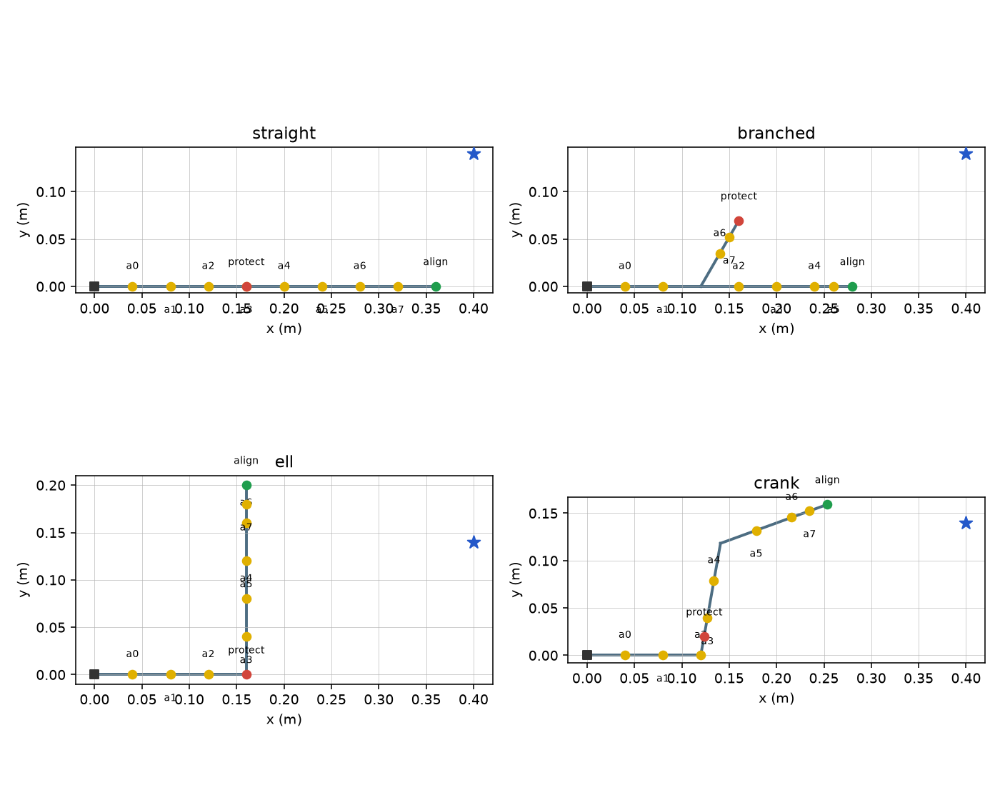
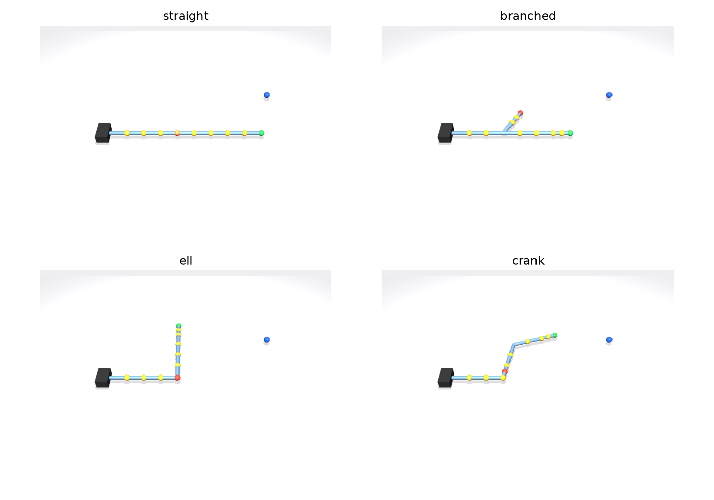
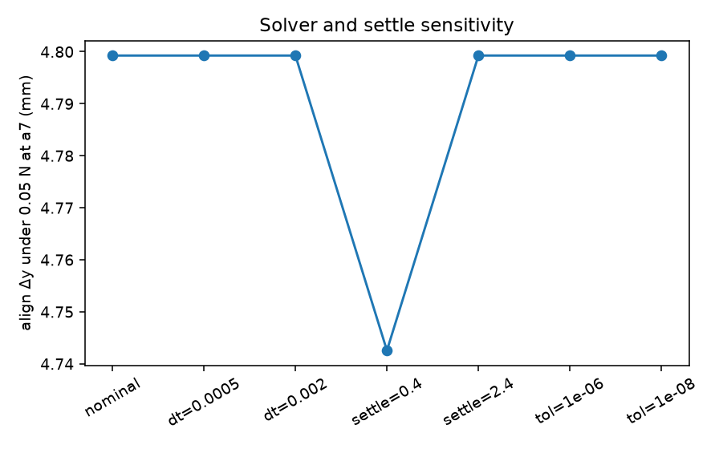
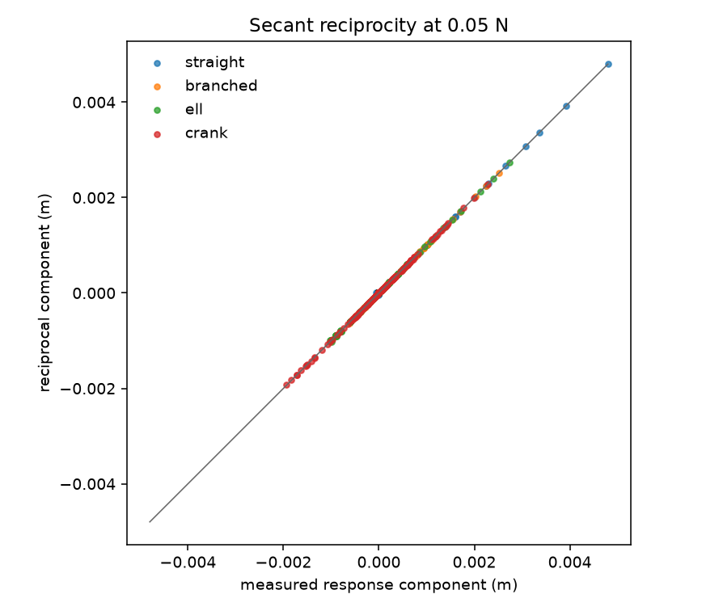
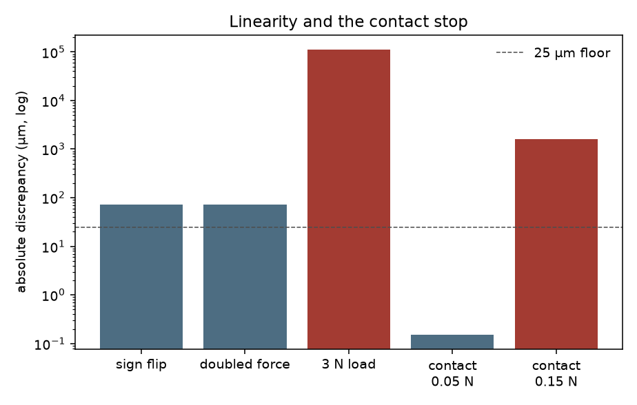
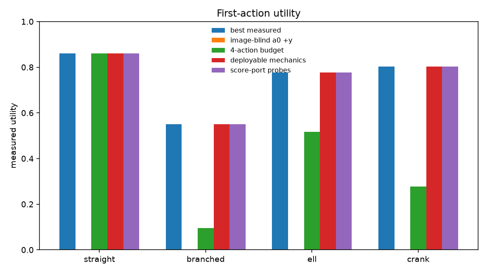

# Phase 2 feasibility: elastic reciprocity for first-action selection

Physics and task study only. No representation learning, no new PHINO loss, and no change to the existing grids. Code: `scripts/phino_reciprocity_feasibility.py`. Tests: `tests/test_phino_reciprocity.py`. Tables and figures: [`docs/results/phino_reciprocity_feasibility_v1/`](results/phino_reciprocity_feasibility_v1/).

**Verdict: NO-GO** for a controlled Phase 2 learning experiment based on this intervention.

Confirming Maxwell–Betti reciprocity on a spring assembly is not a research contribution. The useful result is that the proposed training advantage does not survive a deployable mechanics baseline.

## Question

Can small-force probes at two scoring ports, using Maxwell–Betti reciprocity, supply first-action labels that are worth collecting on an unfamiliar flexible part?

Under a small, quasi-static, linear elastic response with fixed supports,

\[
C = B^\top K^{-1} B = C^\top.
\]

A load at port \(i\), with displacement read at port \(j\), then matches the swapped measurement. The candidate task is to choose one initial force that moves an alignment port toward a fixed workspace target and limits motion of a protected port.

## Fixture and assumptions

The fixture is a clamped planar chain of rigid links and revolute springs. It is not a continuum bracket and not a validated model of a real part. MuJoCo integrates the damped mechanism; the reported response is the settled static displacement.

| Assumption | Value |
|---|---|
| Gravity | off, so the drawn shape is the unloaded equilibrium |
| Spring rate | 4.0 N·m/rad, the same at every joint |
| Link length | 40 mm |
| Damping | 0.5 N·m·s/rad, so the chain settles in 1.2 s |
| Timestep / solver | 1 ms, Newton, tolerance 1e-12 |
| Forces | world-aligned, applied at the material port |
| Joint range | ±1.2 rad; nominal loads do not reach it |

Gravity-free incremental compliance matches a sagged bracket only when preload geometric stiffness is negligible. That case was not simulated. Axial shortening under bending is second order, so the finite-force secant equals the symmetric tangent compliance only up to terms that vanish with the force.

Four geometries share the clamp, the camera, the port naming `a0`–`a7`, and the goal point \((0.40, 0.14)\) m. Yellow ports are candidate contacts. Green is the alignment port. Red is the protected port. The blue star is the goal.

On the straight cantilever the protected station is the same material point as `a3`. On the branched, L, and crank fixtures the scoring ports are not candidate contacts.

## Pre-registered task

Fixed before the MuJoCo ranking. The scales were chosen on the linearized straight beam so its best action is interior, then checked once on the linear model so the L-bracket prefers a different direction. They were not revised after measurement.

| Term | Definition |
|---|---|
| Alignment | clip(progress / 5 mm, 0, 1), progress = displacement of the alignment port along the direction from its rest position to the goal |
| Protection | clip(max(0, \(\|d\|\) − 1.5 mm) / 3.5 mm, 0, 1) |
| Force | \(\|f\| / 0.15\,\mathrm{N}\) |
| Utility | clip(alignment − 0.55 × protection − 0.18 × force, 0, 1) |

Candidate actions: ports `a0`–`a7`, directions \(\pm x,\pm y\), magnitudes 0.05 N and 0.15 N (64 actions). A clear decision was pre-declared as a utility gap of at least 0.05. Reciprocal secants agree when the displacement mismatch is at most the larger of 25 µm (0.5% of the 5 mm target) and 2% of the larger block.

## Reciprocity, linearity, and numerical stability

Five repeats of the same 0.05 N load on the straight beam matched to 0 µm. Among solver settings that actually settled, the tip response varied by 0.004 µm and the reciprocal gap by 0.35 µm. A 0.4 s settle does not equilibrate (max joint speed \(6.6\times 10^{-4}\) rad/s) and moves the tip reading by 57 µm, from 4.743 mm to the settled 4.799 mm. Timestep (0.5–2 ms) and solver tolerance (1e-12 to 1e-6) do not move the settled reading at this precision.

Every reciprocal pair at 0.05 N meets the pre-registered rule. The worst pair on each geometry, and the relative error of the measured secant against the independent linearized spring matrix:

| Geometry | Worst pair | Mismatch | Relative to that pair | Secant vs linear model |
|---|---|---|---|---|
| Straight | `a7`, align | 55 µm | 1.1% | 0.66% |
| Branched | `a5`, align | 19 µm | 0.75% | 0.42% |
| L-bracket | `a7`, align | 40 µm | 1.3% | 0.63% |
| Crank | `a7`, align | 14 µm | 0.37% | 0.97% |

On the straight beam the transverse part of the response is linear at these forces. Reversing 0.05 N flips the \(y\) displacement with error 0. Doubling it misses the linear prediction in \(y\) by 4.4 µm. The 72 µm vector residual is axial shortening, which is even in the force and is outside the first-order reciprocal map.

The approximation fails in two controlled ways, both on the straight beam:

| Condition | Result |
|---|---|
| 3.0 N at `a7`, no contact, joint angle 0.17 rad, limit not reached | 113 mm away from the linear extrapolation |
| 0.05 N with a stop 2.5 mm above the protected port | no contact; reciprocal \(y\) gap 0.15 µm |
| 0.15 N into that stop | one contact, 79 µm penetration; reciprocal \(y\) gap 1.62 mm |

Local reciprocity at 0.05 N and the finite-load failure are different facts. The second is not a free label for the first.

## Optimal actions

Measured by executing every candidate from the same rest state.

| Geometry | Best action | Utility | Gap to the next action | Next action |
|---|---|---|---|---|
| Straight | `a7`, \(+y\), 0.05 N | 0.861 | 0.167 | `a3`, \(+y\), 0.15 N |
| Branched | `a4`, \(+y\), 0.15 N | 0.550 | 0.049 | `a5`, \(+y\), 0.15 N |
| L-bracket | `a5`, \(+x\), 0.15 N | 0.777 | 0.093 | `a6`, \(+x\), 0.15 N |
| Crank | `a7`, \(+x\), 0.15 N | 0.802 | 0.043 | `a6`, \(−y\), 0.15 N |

The four optima differ in port, direction, or magnitude. Transferring the straight-beam winner (`a7`, \(+y\), 0.05 N) scores 0.096 on the branch, and 0 on the L-bracket and the crank, where that push moves the alignment port away from the goal. The image-blind action (`a0`, \(+y\), 0.05 N) scores 0 on every geometry, including the straight beam: a push next to the clamp does not produce the required tip motion.

The branched and crank runner-up gaps, 0.049 and 0.043, sit just under the pre-registered 0.05 line. Those two rankings are real relative to the 25 µm measurement floor, and they are not sharp. The cross-geometry change is sharp. The task was not too easy for a fixed action.

## Mechanics baselines

| Predictor | What it is allowed to use | Measured regret |
|---|---|---|
| Privileged oracle | joint stiffness read from the MuJoCo model, plus the linearization | 0 on all four |
| Deployable mechanics | drawn geometry, support, port locations, and the declared 4.0 N·m/rad rate | 0 on all four |
| Image-blind | `a0`, \(+y\), 0.05 N | 0.55–0.86 |
| Fixed 4-action budget | `a0`/`a7` × \(+x\)/\(+y\) at 0.05 N, then the best of those four | 0, 0.45, 0.26, 0.52 |

The oracle and the deployable model match because the simulator was built with the declared rate. The deployable function does not read `jnt_stiffness`, applied forces, or `qpos`. Access to the MuJoCo state is not being presented as an image-only method.

A sensitivity check, not the baseline: if the same drawing is paired with 8.0 N·m/rad instead of 4.0, the chosen action changes. Measured regret is 0.37 (straight), 0.049 (branched), 0.14 (L), and 0.073 (crank). An unknown modulus would leave a residual. This fixture does not have an unknown modulus. Hiding one would repeat the identifiability failure already recorded for mass and friction: identical images with an arbitrary hidden label.

## What the probes actually buy

Loading the alignment port and the protected port along \(+x\) and \(+y\) at 0.05 N is four settled simulations (4 × 1200 steps). Symmetry copies those columns into the scoring-port rows. That identifies every 2×2 block that touches a scoring port. It does not identify action–action blocks: 21 pairs on the straight beam (`a3` is the protected point, so pairs that touch it are identified) and 28 pairs on each of the other three. It does not identify the contact response or the 3 N response.

Checked against candidate loads that were not used to build the probe matrix:

| Geometry | Max error at 0.05 N | Max error at 0.15 N, scaled from the 0.05 N secant | Regret of the probe's chosen action |
|---|---|---|---|
| Straight | 41 µm | 324 µm | 0 |
| Branched | 14 µm | 114 µm | 0 |
| L-bracket | 29 µm | 181 µm | 0 |
| Crank | 65 µm | 376 µm | 0 |

Same-force reciprocity is within the usefulness rule. Extrapolating to 0.15 N is worse, as the linearity section says it should be, but the argmax still matched the executed optimum. A direct calculator on these four labels does that. Nothing here shows that a learned representation would do better with the same labels.

Against an equal budget of four simulations, the probes beat the fixed four-action set on the branch (regret 0 vs 0.45), the L (0 vs 0.26), and the crank (0 vs 0.52). They tie on the straight beam because that budget happens to contain `a7`, \(+y\), 0.05 N. The mechanics baseline uses zero simulations and also has regret 0. There is no equal-cost reason to prefer an intervention policy over the spring model when the rate is the declared one.

## Go / no-go

| Prerequisite | Result |
|---|---|
| Simulation credible in the stated regime | Met. Settled uncertainty 0.35 µm, under the 25 µm floor. |
| Reciprocity within the pre-registered tolerance at a useful force | Met at 0.05 N. Not met at the contact stop or at 3 N. |
| Visible geometry changes the optimal first action | Met. Four different optima. Two within-geometry gaps are just under 0.05. |
| Not trivial for an image-blind policy | Met. The fixed proximal push scores 0. The straight-beam action does not transfer. |
| Not trivial for the deployable mechanics baseline | Failed. Regret 0 on every geometry. |
| Goal-side probes predict candidate actions that were not executed | Met at 0.05 N, and the selected action matched. |
| Reason to compare intervention strategies at equal simulator cost | Failed. The spring model already solves the task at zero cost. |

**NO-GO.** Do not start a learning experiment on reciprocal probes for this class of object.

The smallest check that could reopen the question is a part whose small-load compliance is not fixed by visible geometry plus a known modulus, and that still obeys reciprocity at the force used for labels. The contact stop and the 3 N load in this study are not that part: reciprocity itself fails there, so those responses are not free labels. An arbitrarily hidden spring rate is not that part either.

## Limitations

- One spring rate, four hand-built geometries, one goal point, and one pre-registered utility.
- Planar lumped springs, no gravity, no friction, no material variation.
- The 25 µm / 2% rule is a decision floor, not a claim of continuum-mechanics accuracy.
- Runner-up gaps of 0.043 and 0.049 are below the clear-decision line even though the cross-geometry gaps are not.
- Rendering is a noiseless MuJoCo view. No image encoder was trained, on purpose.
